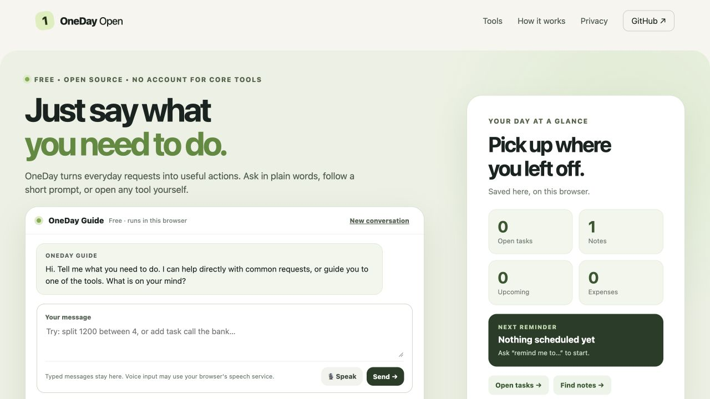

# OneDay Open

**Say what you need to do. Get a useful next step.** OneDay Open is a mobile-first, open-source browser workspace for everyday words, links, money, plans, and files. A free browser guide handles common requests in plain language, asks for missing details, and opens a focused tool when needed. There is no account requirement for the core tools.



> Public beta, v0.2.0. The guide uses explicit rules and local calculations, not a general AI model. It will not understand every request. Some actions require a network connection or browser support, and none should be treated as professional advice or a guarantee of safety.

## Try it

Open **[the live app](https://aryalmilan-max.github.io/oneday-open/)** or run locally:

```sh
git clone https://github.com/Aryalmilan-max/oneday-open.git
cd oneday-open
python3 -m http.server 8000
```

Visit `http://localhost:8000`. A local server is needed for modules and the service worker.

### Talk to the guide

Try these exact requests in the conversation box:

- `split a bill` → answer the total and number of people, or type `split 1200 between 4 with 10% tip` for a direct result.
- `add task call the bank`, `show tasks`, then `mark task bank done`.
- `note: bring documents`, then `find notes about documents`.
- `remind me to call Alex tomorrow at 9am` → a local reminder and downloadable calendar file.
- `clean this link: https://example.com/?utm_source=ad&item=1`.
- `20% of 350`, `convert 5 km to mi`, or `how much have I spent`.
- Paste a long message, then ask `summarize that` or `find details in that`.

The guide also routes requests for translation, OCR, PDF work, image compression, and replies to focused tools. Its **Speak** button uses browser speech recognition when supported. You can always search and open any of the 27 tools directly.

## 27 actions in one repository

| Area | Actions |
| --- | --- |
| Understand | Quick summary, reading stats, find key details, compare text, translate text, scan image text, voice to text, read aloud |
| Communicate | Clean up text, reply starter |
| Trust | Inspect a link, clean a link, check a quote, password generator |
| Money | Split a bill, percentage calculator, unit converter, currency estimate, expense log |
| Organize | Quick notes, task list, due-date reminder, calendar event |
| Files | Compress an image, combine PDFs, extract PDF text, share a text card |

The summary is extractive, the reply starter uses editable templates, link inspection checks visible URL signals, and quote checking searches exact words in text supplied by the user. They do not claim to understand or verify everything. The due-date reminder is visible only while the page is open; it also downloads an `.ics` calendar file so your calendar app can handle notifications.

## Privacy and external services

The guide runs in the browser. Conversation messages are kept only in the open page and disappear when it reloads or you start a new conversation. Notes, tasks, expenses, and reminders use this browser's `localStorage`; use **Export my saved data** to keep a copy. Browser storage is not encrypted. OneDay does not have a user account, analytics, or a server collecting your inputs.

The following actions have explicit online dependencies:

| Action | What happens |
| --- | --- |
| Translate text | Sends the entered text to [MyMemory](https://mymemory.translated.net/doc/spec.php). Do not submit secrets or sensitive text. |
| Currency estimate | Requests a dated reference rate from [ExchangeRate-API](https://www.exchangerate-api.com/docs/free). It is not a payment quote. |
| Scan image text | Downloads [Tesseract.js](https://github.com/naptha/tesseract.js) and language data; image processing stays in the browser. |
| Combine PDFs | Downloads [pdf-lib](https://pdf-lib.js.org/); PDFs stay in the browser. |
| Extract PDF text | Downloads [PDF.js](https://mozilla.github.io/pdf.js/); PDF processing stays in the browser. |
| Voice to text | Uses the browser's speech recognition, which may process audio through a browser vendor. |

See [PRIVACY.md](PRIVACY.md) for details and limits.

## Why one repo?

OneDay has a shared conversation and a shared result flow. The same text can become a summary, note, task, calendar event, or share card. The guide's parser is in `guide.mjs` and has no AI service dependency. The code is intentionally buildless HTML, CSS, and JavaScript so anyone can inspect, fork, and host it without a paid service. The service worker caches first-party app files for offline use after the first visit. Online-dependent actions still need connectivity.

## Test and contribute

```sh
npm run check
```

Node.js 20+ is needed only for checks, not for running the app. See [CONTRIBUTING.md](CONTRIBUTING.md) and [ROADMAP.md](ROADMAP.md). Security issues should follow [SECURITY.md](SECURITY.md).

## Adoption

Stars are welcome, but the useful signals are people completing real tasks, returning, reporting bugs, and contributing translations or improvements. There is no claim that publication will reach a particular number of users.

MIT licensed. See [LICENSE](LICENSE).
